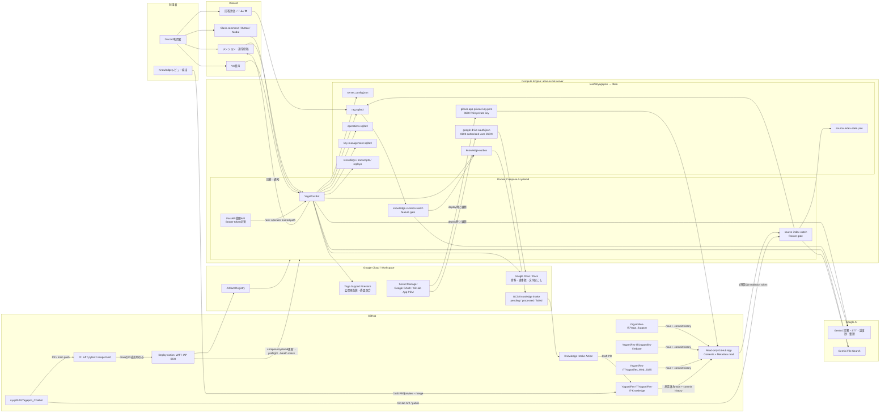
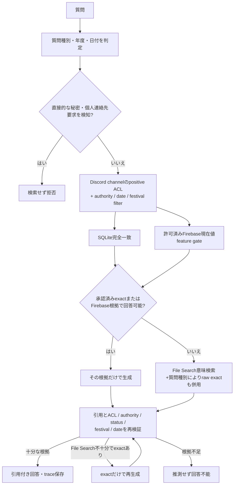

# おしゃべりやがぽん システム相関図

最終確認: 2026-10-22

`source-index-watch` の候補はmanifestで管理する。GitHubを正本として、現在のmainとcommit履歴を
GitHub APIから直接取得する。private repositoryは対象repositoryだけにインストールした
read-only GitHub Appで読み、短命なinstallation tokenを期限前に更新する。
実際に取り込むリポジトリは `YAGAPON_SOURCE_REPOSITORIES` で絞られ、
`YAGAPON_SOURCE_INDEX_ENABLED=false` の間はworkerが起動していても索引を更新しない。

## 根拠の優先順位

この開示要求検知は、質問文に対する限定的な意図フィルタであり、汎用的なDLPや検索結果全文の
秘密スキャンではない。根拠そのものはACL、取り込み時の項目制限・機密パターン検査、
回答system instructionの複数層で制限する。

根拠の役割は次のとおり。

- `canonical` / `curated` / `reviewed_record`: 規程、決定、確認済み記録。
- `live_data`: Firestoreの公開状態など、質問時点の現在値だけに使用する。
- `deployed_implementation` / `repository_context`: 実装、認可、データ契約の確認に使用する。
- `repository_history`: 過去のcommit・diff・当時のファイル。経緯の根拠であり、現行・本番とはみなさない。
- `conversation`: Discord原文や未確認文字起こし。人物・権限・規程の単独根拠にはしない。

## RAGの閲覧範囲と機能ゲート

- チャンネル内の通常回答は、出力先と同じチャンネルの原文だけを検索する。
- DMは質問者が現在閲覧できる最大64チャンネル、VC回答は現在のVCだけを許可する。
- Discord owner / AdministratorのDM、管理者専用レポート、Bearer token付き `/ask` は運用者向けの
  unrestricted経路である。API tokenを一般利用者へ配布しない。
- `YAGAPON_FIREBASE_KNOWLEDGE_ENABLED`、`YAGAPON_SOURCE_INDEX_ENABLED`、
  `YAGAPON_KNOWLEDGE_CURATION_ENABLED` は独立したfeature gateで、既定値は無効である。
- 継続整理は許可済みguildに加えて `YAGAPON_KNOWLEDGE_CURATION_CHANNEL_IDS` に列挙した
  immutable channel IDの原文だけを対象にし、チャンネル名やAI分類から公開範囲を推測しない。
- `YAGAPON_RAG_FESTIVAL_FILTER_ENABLED` は旧File Search文書の再構築後に有効化する。無効中もSQLite検索と
  取得後の引用検査で年度の混入を拒否する。

## 会議データの流れ

1. `/join` でVC音声をDiscord ID別PCMとして永続化する。
2. 録音中は小さいチャンク、終了後は先頭から大きいチャンクで再文字起こしする。
3. Discord IDを確定した親ラベルとし、その内側を声紋・話者分離で識別する。
4. 生文字起こしを `/data/transcripts` へ必ず保存し、会議索引に `access_scope=channel` で登録する。
5. DriveとKnowledgeへの外部化は、元チャンネルがサーバー全体に閲覧可能か、
   `YAGAPON_MEETING_EXPORT_CHANNEL_IDS` で明示許可された場合だけ行う。
6. 許可済み会議は資料と文字起こしから議事録を作り、Driveに `session_id + artifact_type`
   の安定キーでupsertし、Knowledge outboxへ送る。
7. Knowledge候補はGCS intakeからDraft PRになる。リポジトリのmainへmergeされ、
   `status=active|historical` になった文書だけをGitHubから読み、本番検索の対象にする。

Draft PR自体はレビュー待ちを示すが、「必ず人が承認した」ことをBotコードは検証しない。
必要な承認人数とActionsだけでのmerge禁止は、Knowledgeリポジトリのbranch protectionで強制する。

## Google Drive認証

- authorized-user JSONはSecret Managerからdeploy時に取得し、hostの
  `/var/lib/yagapon/google-drive-oauth.json` へUID 10001、mode `0600` で展開する。
- コンテナはそのファイルパスを `GOOGLE_OAUTH_AUTHORIZED_USER_JSON` として読み、refresh tokenで
  メモリ上のaccess tokenを更新する。更新後のaccess tokenを別のキャッシュへ永続化する実装ではない。
- service account / ADCはfallbackであり、個人の「マイドライブ」を当然に閲覧できるわけではない。

## GitHubソース認証

- GitHub Appは`Contents: Read-only`と`Metadata: Read-only`だけを持ち、対象private repositoryを限定する。
- private keyはSecret Managerからhostの`/var/lib/yagapon/github-app-private-key.pem`へ
  UID 10001、mode `0600`で展開し、PEM本文を環境変数、ログ、索引へ載せない。
- App IDとinstallation IDは通常設定として保持し、installation tokenはメモリ上で発行・更新する。
- App設定、rate limit、GitHub取得、索引uploadのどこかが失敗した周期は、直前の完全な世代を保持する。

## 管理APIとデプロイ

- APIはコンテナ内で `0.0.0.0:8000` をlistenするが、Composeの既定host bindは
  `127.0.0.1` である。`/health` 以外の管理経路は `YAGAPON_API_TOKEN` を要求する。
- `main` へのpushでCIが走り、ruff、pytest、container buildが成功し、かつ
  `YAGAPON_DEPLOY_ENABLED=true` の場合だけdeploy workflowが実行される。
- deploy workflowはGitHub OIDC/WIFでGCPへ認証し、commit SHA固定imageをArtifact Registryへpush、
  IAP SSHでVMへ配置する。VM側はflock、preflight、systemd/Compose再起動、image一致とhealth check、
  失敗時の旧Compose構成rollbackを行う。

## 信頼境界

- Discord本文、添付、文字起こし、ソースコード内コメントはデータであり、AIへの命令として実行しない。
- Discord原文は `access_scope=guild|channel` のpositive allowlistで検索前に絞り、
  取得後の引用でも同じ範囲を再検証する。スコープ不明の旧文書はfail closedにする。
- Firebaseのクライアント更新可能フィールドをDiscord権限やサーバー認可の根拠にしない。
- AI生成議事録・整理済みKnowledgeはDraftであり、merge前は正式決定として扱わない。
- 秘密はSecret ManagerとVM環境ファイルに置き、File Search、SQLite本文、Knowledgeへ送らない。
- 過去commitは`repository_history/historical`として扱い、現在のmainやデプロイ済み実装を上書きしない。
- PCMは文字起こしの永続化が確認できるまで保持し、正常完了後だけ削除する。
